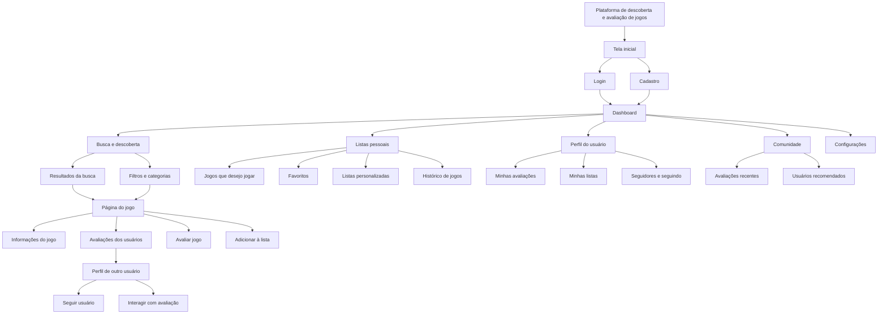
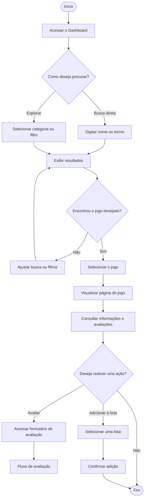
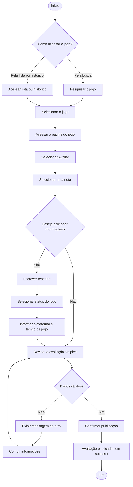
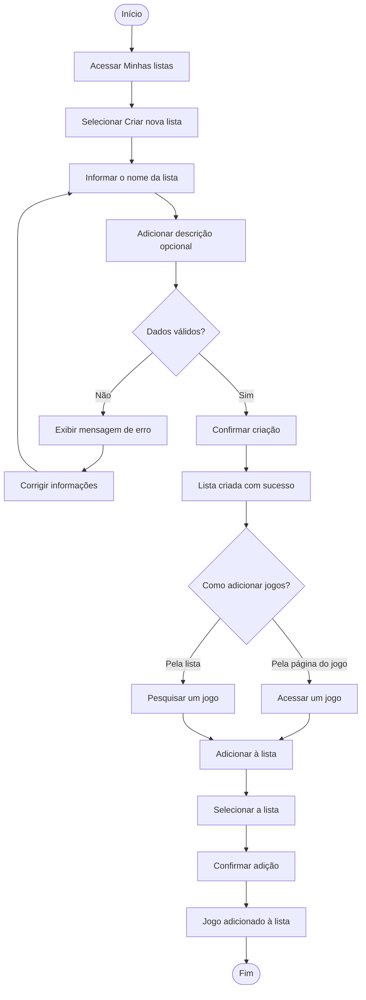
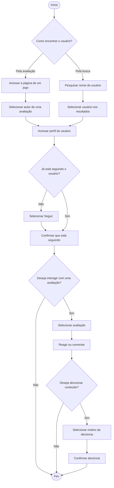

# Arquitetura de Informação e Fluxo do Usuário

> Esta etapa organiza as principais telas, funcionalidades e caminhos de navegação da plataforma, considerando as necessidades identificadas nas pesquisas, personas, cenários e análise de tarefas.

## 1. Arquitetura de Informação

### 1.1 Telas e seções principais

- **Tela inicial**
  - Apresentação da plataforma
  - Login
  - Cadastro

- **Página inicial / Dashboard**
  - Jogos em destaque
  - Recomendações
  - Atividades recentes
  - Acesso à busca
  - Acesso às listas e ao perfil

- **Busca e descoberta**
  - Campo de busca
  - Resultados da busca
  - Filtros por gênero, plataforma, status e características
  - Categorias e recomendações

- **Página do jogo**
  - Capa e informações principais
  - História e descrição
  - Gameplay
  - Gêneros
  - Plataformas disponíveis
  - Desenvolvedora
  - Trailer e imagens
  - Nota geral
  - Avaliações dos usuários
  - Opções para avaliar e adicionar a listas

- **Avaliação do jogo**
  - Nota
  - Resenha opcional
  - Status do jogo
  - Plataforma utilizada
  - Tempo de jogo
  - Data da avaliação
  - Revisão e confirmação da publicação

- **Listas pessoais**
  - Jogos que deseja jogar
  - Jogos favoritos
  - Listas personalizadas
  - Histórico de jogos
  - Opção para criar, editar e excluir listas

- **Perfil do usuário**
  - Informações básicas
  - Avaliações publicadas
  - Listas criadas
  - Histórico de jogos
  - Seguidores e usuários seguidos

- **Comunidade**
  - Avaliações recentes
  - Interações nas avaliações
  - Acesso aos perfis dos autores
  - Opções de seguir, reagir e denunciar conteúdo

- **Configurações**
  - Edição de perfil
  - Preferências da conta
  - Privacidade
  - Notificações
  - Acessibilidade
  - Sair da conta

### 1.2 Sitemap

### 1.3 Justificativa da organização

A arquitetura foi organizada a partir das principais necessidades identificadas na pesquisa com os usuários.

A tela inicial concentra o login e o cadastro, permitindo que o usuário entre na plataforma antes de acessar seus recursos pessoais. Depois da autenticação, o usuário é direcionado ao Dashboard, que funciona como ponto central de acesso às principais funcionalidades.

A busca e a descoberta foram organizadas como uma seção própria porque encontrar jogos relevantes é uma das necessidades centrais das personas. A partir dos resultados, o usuário pode acessar a página detalhada de um jogo, consultar avaliações, publicar sua própria opinião ou adicionar o jogo a uma lista.

As listas pessoais e o histórico ficam agrupados porque respondem ao interesse dos usuários em organizar os jogos que desejam jogar, já jogaram ou consideram favoritos. Essa organização também atende ao dado de que 64,6% dos participantes da pesquisa utilizam listas de desejos.

A comunidade e os perfis foram estruturados para facilitar a interação entre usuários com interesses semelhantes. O usuário pode consultar avaliações, acessar o perfil de quem publicou uma opinião e seguir pessoas que possuam gostos compatíveis.

A arquitetura também prioriza a simplicidade e a facilidade de navegação, evitando que o usuário precise percorrer muitos menus para encontrar jogos, avaliações ou listas.

---

## 2. Fluxos do Usuário

### 2.1 User Flow — Descobrir um jogo

**Funcionalidade:** permitir que o usuário encontre jogos por meio da busca, filtros ou categorias.

**Objetivo do usuário:** localizar um jogo relevante e consultar suas informações antes de decidir se deseja jogá-lo ou adicioná-lo a uma lista.

O fluxo oferece dois caminhos alternativos: busca direta ou exploração por categorias e filtros. Essa alternativa atende tanto usuários que já sabem qual jogo procuram quanto usuários que desejam descobrir algo novo.

Em caso de resultados inadequados, o usuário pode ajustar os termos ou filtros sem precisar retornar ao início do sistema.

### 2.2 User Flow — Avaliar um jogo

**Funcionalidade:** permitir que o usuário registre uma avaliação sobre um jogo.

**Objetivo do usuário:** publicar uma opinião de forma rápida, podendo adicionar informações detalhadas caso deseje.

O usuário pode publicar apenas uma nota ou complementar a avaliação com resenha, status, plataforma e tempo de jogo. Essa flexibilidade reduz o tempo necessário para avaliar um jogo e atende à necessidade identificada de evitar formulários longos.

Antes da publicação, o sistema apresenta uma etapa de revisão para reduzir erros. Caso alguma informação obrigatória esteja ausente ou inválida, o usuário recebe uma mensagem clara e pode corrigir o formulário.

### 2.3 User Flow — Criar uma lista personalizada

**Funcionalidade:** permitir que o usuário crie uma lista e adicione jogos a ela.

**Objetivo do usuário:** organizar jogos de acordo com seus interesses, como jogos favoritos, jogos que deseja jogar ou jogos de determinado gênero.

O usuário pode criar uma lista informando um nome e, opcionalmente, uma descrição. Depois, pode adicionar jogos a partir da própria lista ou diretamente na página de um jogo.

Esse fluxo contempla dois caminhos alternativos, pois a decisão de organizar um jogo pode acontecer enquanto o usuário está pesquisando ou depois de consultar os detalhes de um título específico.

### 2.4 User Flow — Seguir um usuário e interagir com uma avaliação

**Funcionalidade:** permitir que o usuário encontre perfis com interesses semelhantes e acompanhe suas avaliações.

**Objetivo do usuário:** descobrir pessoas com gostos compatíveis e interagir com opiniões relevantes sobre jogos.

O usuário pode chegar ao perfil por meio de uma avaliação que considerou relevante ou por uma busca direta pelo nome. O primeiro caminho é especialmente importante para a persona Sofia, que deseja encontrar pessoas com interesses semelhantes a partir de opiniões sobre jogos.

Depois de acessar o perfil, o usuário pode seguir a pessoa e interagir com suas avaliações. Também existe um caminho de denúncia para situações em que o conteúdo viole as regras da comunidade.

## 2.5 Relação entre a arquitetura, os requisitos e as tarefas

A arquitetura e os fluxos foram definidos com base nas funcionalidades prioritárias identificadas na análise de tarefas:

| Necessidade identificada | Funcionalidade relacionada | Elementos da arquitetura |
|---|---|---|
| Encontrar jogos relevantes | Descobrir um jogo | Busca, filtros, categorias e recomendações |
| Avaliar jogos de forma rápida | Avaliar um jogo | Página do jogo e formulário de avaliação |
| Organizar jogos | Criar listas personalizadas | Listas pessoais, favoritos e histórico |
| Encontrar pessoas com interesses semelhantes | Seguir e interagir com usuários | Comunidade, avaliações e perfis |
| Consultar informações completas | Visualizar página do jogo | História, gameplay, gênero, plataforma e avaliações |
| Evitar erros durante as tarefas | Revisar e confirmar ações | Mensagens de erro, validação e confirmação |

A organização proposta mantém as funcionalidades principais próximas do Dashboard e da página do jogo. Dessa forma, o usuário consegue realizar as tarefas mais importantes — descobrir, avaliar, organizar e interagir — com poucos passos e sem precisar navegar por estruturas complexas.
